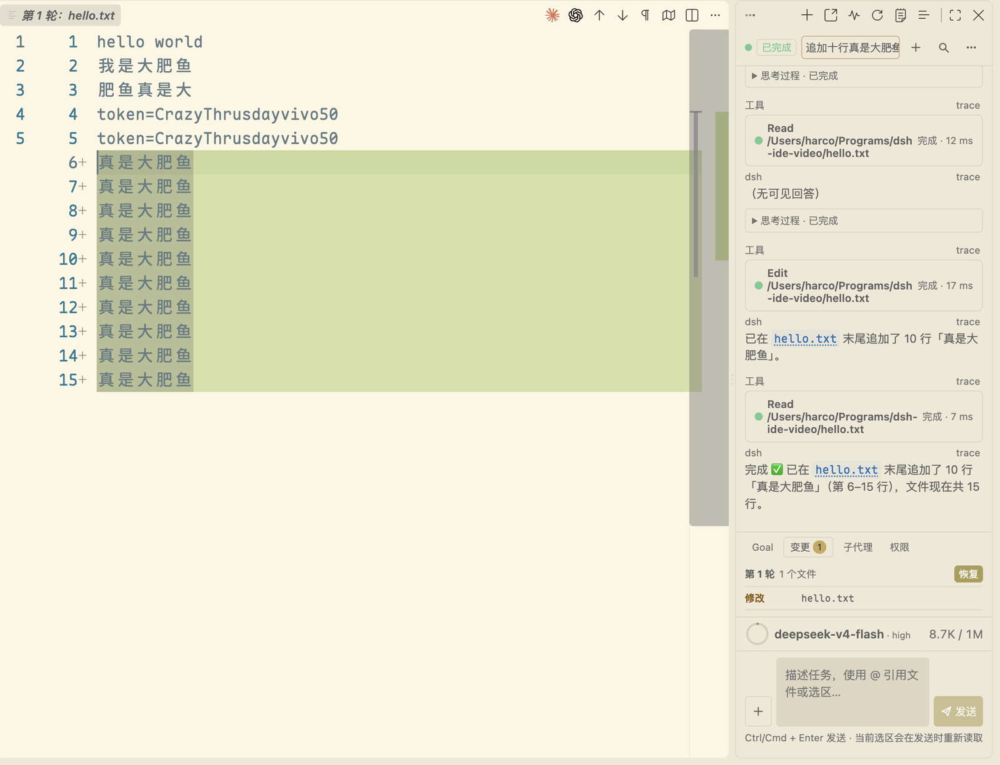
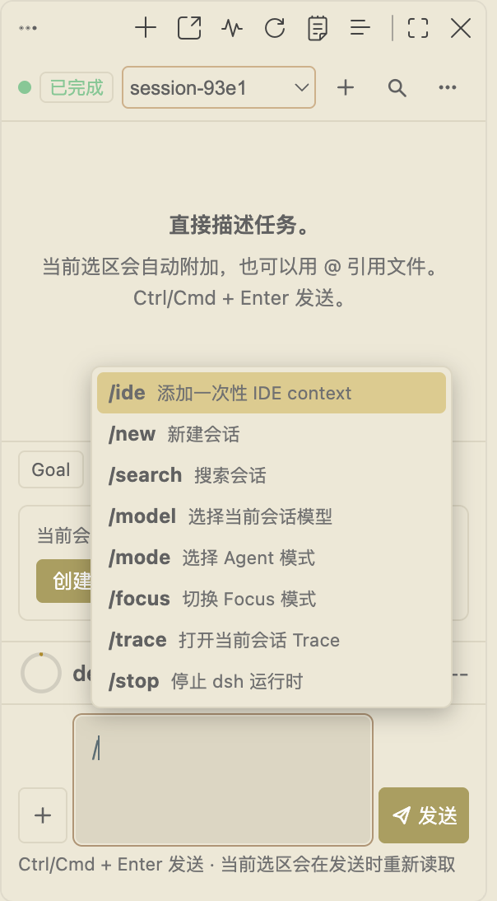
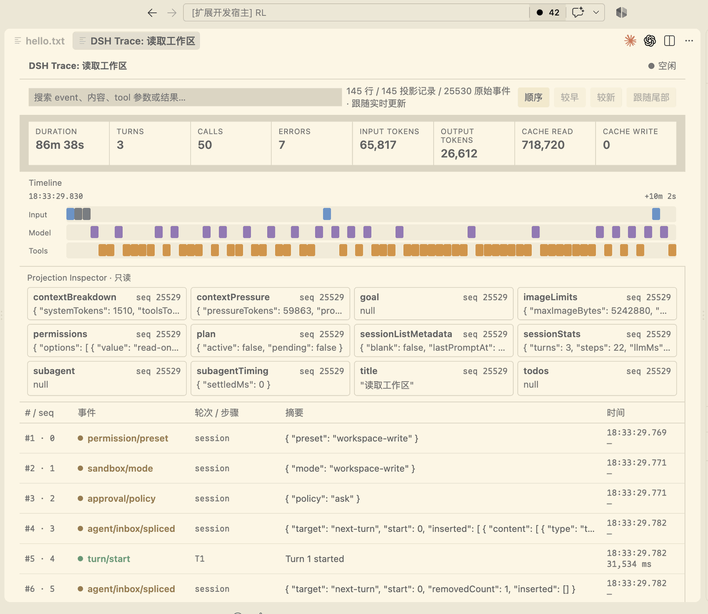
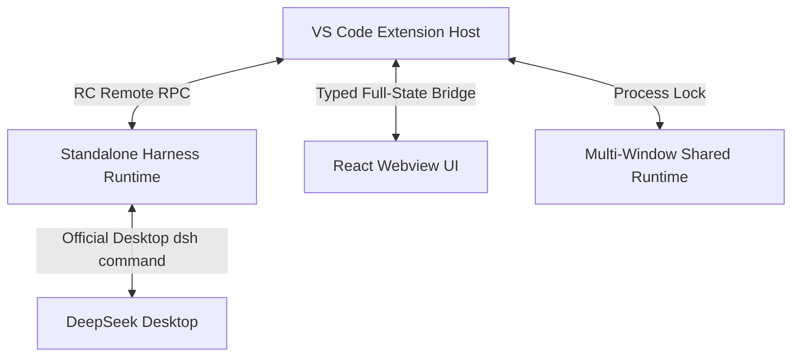

<p align="center">
  
</p>

<h1 align="center">DeepSeek Harness for VS Code</h1>

<p align="center">
  <strong>Your coding agent, with every change in view.</strong><br>
  Bring DeepSeek Harness (DSH) into VS Code: work with your code, review native diffs, and follow each task with built-in Trace and usage insights.
</p>

<p align="center">
  
  
  
</p>

<p align="center">
  <strong>English</strong> | <a href="README.zh-CN.md">简体中文</a>
</p>

<p align="center">
  <a href="https://open-vsx.org/extension/harcochen/dsh-vsc-integration"></a>
  <a href="https://marketplace.visualstudio.com/items?itemName=HarcoChen.dsh-vsc-integration"></a>
  <a href="https://github.com/HarcoChen/dsh-vsc-integration/stargazers"></a>
  <a href="https://github.com/HarcoChen/dsh-vsc-integration/blob/main/LICENSE"></a>
</p>

<p align="center">
  <a href="https://marketplace.visualstudio.com/items?itemName=HarcoChen.dsh-vsc-integration"><strong>Install for VS Code</strong></a> ·
  <a href="https://open-vsx.org/extension/harcochen/dsh-vsc-integration">Open VSX</a> ·
  <a href="https://github.com/HarcoChen/dsh-vsc-integration/releases">Download VSIX</a> ·
  <a href="CHANGELOG.md">Changelog</a>
</p>

<p align="center">
  <em>An independent community project. <a href="https://github.com/HarcoChen/dsh-vsc-integration/issues">Issues</a> welcome.</em>
</p>

<p align="center">
  For JetBrains IDEs (IDEA, PyCharm, etc.), please see <a href="https://github.com/HarcoChen/dsh-intellij-integration">dsh-intellij-integration</a>.
</p>

<p align="center">
  
</p>

## Highlights

| | |
| --- | --- |
| **Runtime target `0.2.2-rc.1`** | Session management, account sign-in, DSH Workspaces, timed questions and Schedule use the pinned Remote contract. Newer CLI versions can connect, but feature compatibility depends on their APIs. See the [maintenance report](MAINTENANCE.md) for 0.2.2 changes and remaining checks. |
| **Laya / Jev built in** | The IDE-neutral [`dsh-jev-integration`](https://github.com/HarcoChen/dsh-jev-integration) Runtime plugin ships inside the extension. Add fast System One decisions from TypeSafe [Jev](https://typesafe.ai/blog/introducing-system-one-models-and-jev), or its wire-compatible open-source alternative [Laya](https://huggingface.co/convaiinnovations/laya), to the agent loop: loop guard, large-output shaping, done-gate, tool pruning, skill routing, and decision tools. Nothing extra to install. |
| **Works out of the box** | Install the extension and the official [DeepSeek Desktop](https://www.deepseek.com/en/download/) app. The Desktop app registers the `dsh` command; the extension finds it, connects to its Web Runtime, and guides you to the download page when it is unavailable. The only setup left is your API key. |

## Why DSH?

- **See what changed.** Review tool edits in VS Code's native side-by-side diff, even outside a Git repository.
- **Decide before execution.** Approval cards show commands and target files, with proposed diffs for supported file writes.
- **Start with context.** Bring files, selections, Git diffs, or paused debugger state into a task without copying everything by hand.
- **Pick up where you left off.** Resume persistent sessions and follow tools, subagents, Todos, and token usage in the Activity panel.
- **Smarter agent decisions, no extra install.** Turn on the built-in Laya/Jev integration to catch loops, trim noisy output, and check completion claims against evidence.

## Quick start

Requires **VS Code 1.106.0 or later** and a configured DSH model provider with credentials.

The default Runtime target is `0.2.2-rc.1`. Integration with `0.2.2-rc.1` covers Host tasks, projection-based subagents, terminals and plugin updates. Optional RC.2 features include failed-generation continuation and Agent terminal takeover. Version-specific validation is recorded in the [maintenance report](MAINTENANCE.md).

1. **Install the extension** from the Marketplace or Open VSX links above, or search for `harcochen.dsh-vsc-integration` in Extensions.
2. **Open chat.** Install and launch the official [DeepSeek Desktop](https://www.deepseek.com/en/download/) app, then open and trust your project folder and run `DSH: Open Chat`. The Desktop app registers `dsh`; if the command is unavailable, the extension offers the official download page.
3. **Set up your provider.** Run `DSH: Configure API Key` for DeepSeek credentials. For other providers, use `DSH: Open dsh Web UI in Browser`. Select or register a DSH Workspace, then choose a model.
4. **Give it a task.** Type `@` to reference a file, or right-click a selection for DSH actions. Follow the task, respond to approval requests, and open diffs from tool cards to review the result.
5. **(Optional) Turn on Laya/Jev.** Enable `dsh.jev.enabled` and the features you want, run `DSH: Configure Jev API Key`, then accept the Runtime restart. See [Laya / Jev System One decisions](#laya--jev-system-one-decisions-built-in).

> A **DSH Workspace** groups sessions in Harness and can be associated with a project path. When using the same Runtime, you can continue sessions created in the Web UI.

### Try it on real work

| Your task | A place to start |
| --- | --- |
| Understand unfamiliar code | Select code and use the DSH explain action: “Walk through the execution flow and edge cases.” |
| Review a change | Use the DSH review action on a Git diff in Source Control: “Check these changes for regressions and point to the relevant lines.” |
| Investigate a breakpoint | While paused, run `DSH: Explain Current Debug State` to attach context including the call stack and local variables. |
| Continue earlier work | Switch to a previous session and use the conversation outline to revisit the discussion. |

## Features

### Native diff for every edit, no Git required

After a `write`/`edit` tool call, open the target file to see VS Code's native side-by-side diff. The before-image is reconstructed by replaying hunks backwards from the Session log, so it also works in non-Git repositories and Git-ignored files.



### Preview before approval

The approval card shows the actual command line, working directory, and target files that will be written. For supported file-writing tools, open a native diff of the proposed change before approving it.

A write whose target file still has unsaved editor changes is not released: approval is refused, the card names the files and stays pending, and you can save or revert them and approve again.

### Laya / Jev System One decisions, built in

[Jev](https://typesafe.ai/blog/introducing-system-one-models-and-jev) is TypeSafe's System One decision model. It does not generate text. It reads an agent state and returns calibrated, typed answers in milliseconds. [Laya](https://huggingface.co/convaiinnovations/laya) is an Apache-2.0 open-weights alternative that serves the same `POST /v1/systemone` request and response shape. The extension bundles the [`dsh-jev-integration`](https://github.com/HarcoChen/dsh-jev-integration) Runtime plugin (shared with the JetBrains plugin) and mounts it into every Runtime it starts. You do not install a separate plugin or edit your DSH profile.

| Feature | Setting | What it does |
| --- | --- | --- |
| Loop guard | `dsh.jev.loopGuard.enabled` | Detects semantic loops after tool execution and steers the agent out. |
| Result shaper | `dsh.jev.resultShaper.enabled` | Classifies and folds repetitive large tool output, and keeps warnings and failures. |
| Done gate | `dsh.jev.doneGate.enabled` | Checks completion claims against tool evidence and can request one more verification turn. |
| Tool pruner | `dsh.jev.toolPruner.enabled` | Ranks model-visible tool schemas. DSH permissions and tool registration are unchanged. |
| Skill router | `dsh.jev.skillRouter.enabled` | Selects relevant skills and adds bounded advice to the context. |
| Decision tools | `dsh.jev.decisionTools.enabled` | Exposes `jev_ask`, `jev_rank`, and `jev_check` tools to the agent. |
| Deterministic safety guard | `dsh.jev.deterministicSafetyGuard.enabled` | Runs local checks for destructive commands, privilege escalation, and credential exposure. Inspected data stays local. |

**Use Jev:** enable `dsh.jev.enabled` plus the features you want, run `DSH: Configure Jev API Key`, and restart the Runtime when prompted. The key is encrypted in VS Code SecretStorage.

**Use Laya:** point `dsh.jev.baseUrl` at an HTTPS endpoint that serves the Laya System One API, set `dsh.jev.model` to the model name that server expects, and configure an API key. If your server ignores the key, any placeholder value works. The extension accepts only `https://` endpoints and falls back to the TypeSafe default for anything else.

Everything is off by default. Enabled features may send the samples they need to the configured endpoint. Existing or externally managed Runtimes are never modified.

### Sessions, account, and schedules (dsh 0.2.0-rc.2)

- `DSH: Manage Sessions` pins sessions and restores archived ones. `DSH: Archive Session` asks whether to stop a running task before it archives the session. DSH Workspaces also work without an open VS Code folder.
- `DSH: Manage DeepSeek Account` signs in through the browser, signs out, and shows the account profile and balance.
- `DSH: Browse Runtime Workspace Files` (also under `/ide`) lists files in the current DSH Session's workspace and opens read-only UTF-8 previews up to 1 MiB. Open previews refresh on Runtime file changes; `DSH: Refresh Runtime File Preview` also works when watching is unavailable.
- When the official Schedule bundle is enabled, the Schedule dock lists reminders across sessions. You can edit daily, weekly, or cron rules, view delivery history, and delete reminders. If the bundle is absent, the dock shows where to enable it.

On `0.2.2-rc.1` and newer, Schedule manages Host-wide tasks with pagination and activity filtering. Create delayed, dated, interval, daily, weekly, cron or RRULE tasks and choose their destination Session. Manage tasks to edit, pause, resume, run, delete or inspect delivery history. Edits detect concurrent changes.

The chat menu provides **Export conversation** for Markdown, JSON or ZIP and **Copy conversation as Markdown**. Text exports read the complete paginated history at one fixed event cursor. Choose ZIP to include binary attachments. Each message also offers **Quote** for the message or selected text. With an empty composer, use ↑/↓ to recall sent prompts and return to your draft. Enable `dsh.completionNotification` for completion notifications while VS Code is unfocused.

### Runtime terminals, plugin installation, and Problems (development branch)

- **DSH: Open Runtime Terminal** opens a Host PTY for the selected DSH Session, also available from the chat menu. Terminals stay open when switching chats; reattachment restores the screen and input ownership. Closing requests Host process cleanup; reopen this command to retry a failed cleanup. Processes are retained for the Host lifetime, and existing terminals keep their own directories. Input uses upstream user-shell permissions.
- **DSH: Install or Remove Runtime Plugins** inspects package metadata through the official manager, installs or removes bundles, and shows progress, logs, cancellation and application/restart outcomes. Paths refer to the Runtime host. Build scripts require separate approval. Settings and the chat menu provide the same entry point.
- Use **Problems from current file** in the attachment or `@` menu to select diagnostics for the next message. Typing `@diagnostics` attaches the current file's diagnostics. Attachments include locations, sources and codes, retain size/truncation limits, and are not sent automatically.
- **DSH: Open Session Center** labels Sessions by DSH Workspace and prioritizes observed approvals, questions, errors and running tasks. Selecting a row continues that Session.
- Chat displays the effective working directory. On alpha.2, directory changes preserve the original project identity; historical tool diffs and file links retain their historical directories. Review a turn spanning multiple directories through individual tool diffs.

### Slash commands enumerated live from the Runtime

The slash menu dynamically fetches commands registered by the Runtime for the current session (`/plan`, `/compact`, `/goal`, etc.) and merges them with the extension's own IDE commands.



### Editor and Git context

- Right-click the current file, selection, or Git diff to explain, fix, review, or generate documentation.
- Right-click `Ask about resource` in Explorer to ask about a file or folder.
- The `@` menu autocompletes project files and previous Sessions.
- `DSH: Capture AppShot` (macOS only) captures a window screenshot and inserts it into the conversation as a draft.

### Sessions, Trace, and Activity at a glance

The sidebar provides a native conversation-outline TreeView. Trace, token usage, Todo lists, and subagents are gathered in the Activity panel. The UI supports VS Code's dark and light themes.

`DSH: Open Chat in Editor Tab` opens an independent conversation tab. Each tab retains its own Session, text draft, context and navigation, while the sidebar can use another Session. Opening the same Session reveals its existing tab. Session tabs and text drafts restore after restarting VS Code. Tabs share the Runtime connection.

### Repository review and Worktrees

Enable the official `@deepseek-ai/dsh-experimental-forge-bundle` in Runtime plugins, then run `DSH: Review Repository and Worktrees` or use the chat menu. The command uses the current DSH Session's directory.

- Compare uncommitted, staged, unstaged or branch changes in native side-by-side diffs. RC.2 adds base-branch and commit selection, review-layer filtering and change-digest progress tracking.
- Request a Worktree before a Session starts its first task. Its first prompt creates the checkout. Controls support cancellation, stopping, retrying, restoring missing directories and returning to the source project.
- Track PR URLs, inspect diffs and checks. RC.2 supports review threads, synced viewed marks, line comments, completed reviews and branch updates guarded by the confirmed head. Publishing and branch updates display confirmation details.

### Desktop connection, ZIP and inline completion

`DSH: Connect to Desktop` accepts an address copied from Desktop's `dsh-vscode-connect` plugin and stores its grant in SecretStorage. Windows local discovery can read account-encrypted records and refresh addresses through the pairing channel. Enter the exact Runtime version shown in Desktop About. `DSH: Disconnect Desktop` clears the saved grant.

Conversation export also offers ZIP for the current Session or its descendants. The Runtime streams persistent logs and binary attachments into the archive, with cancellation during download.

Run `DSH: Complete Code Inline` for ghost text accepted through VS Code's Tab action. Completion uses a separate minimal Session and archives it after completion or cancellation. `dsh.inlineCompletion.automatic` enables requests after a typing pause and defaults to off. Configure a dedicated provider/model or inherit the current chat route. `dsh.imageFileFallback` sends images as files when the model explicitly refuses image input.

### Session preferences, appearance and community plugins

Session center buttons filter by status and DSH Workspace, change sorting and toggle grouping. Preferences persist. Archive notifications offer Undo. The chat menu's appearance action controls font size and compact spacing, and focus mode persists too.

Enable `@deepseek-ai/dsh-experimental-plugin-market-bundle` to browse community plugins from Runtime plugin management. Add index sources, search, page results, read details and choose compatible versions. Installation and updates preserve the market's exact source and registry.

Configure model cost rates to enter your provider/model's per-million-token prices. Estimates use each request's own route, show separate currency totals and identify requests with missing rates. They use current custom rates and exclude non-token charges.

The attachment menu includes prompt-template management, IDE file/symbol context search and explicit rule-document selection. Templates live in the IDE project's `.dsh/prompts`. Rules can be selected from `AGENTS.md`, `.dsh/rules` and `.agents/rules` as one-shot context. Set `dsh.connectionMode` to `attach-only` to connect to existing Runtime processes.



### Autonomous debugging (off by default)

With `dsh.autonomousDebugging` enabled, the extension exposes a loopback MCP endpoint inside
this window and the agent can drive the VS Code debugger: `debug_start` launches a launch
configuration that already exists in the workspace, `debug_breakpoint` adds, removes and lists
breakpoints, `debug_control` continues, steps and waits for the next pause, and `debug_context`
reads the paused stack, variables and source. Variables whose names look like secrets are
replaced with `[redacted by dsh-ide]` before they leave the window. The endpoint binds
`127.0.0.1` only, checks the `Host` header and a per-launch token, and never lets the model
invent a launch configuration. It applies to a Runtime this window starts; switching the setting
needs a Runtime restart, which the extension offers when you change it.

### Credentials and balance

The bottom bar shows your current balance, including peak and off-peak pricing. Low balances are highlighted clearly.


## FAQ

**Do I need to install DSH manually?** Install the official [DeepSeek Desktop](https://www.deepseek.com/en/download/) app. It registers the `dsh` command used by the extension. If the command cannot be found, the extension offers the official download page. Standalone managed Runtime downloads are deprecated.

**How is Laya/Jev integrated?** The extension package carries the IDE-neutral `dsh-jev-integration` Runtime package and mounts it only into a Runtime started by this extension; existing or externally managed Runtimes are not modified. Laya is supported through the same System One contract by changing `dsh.jev.baseUrl` (HTTPS only). Jev is disabled by default. `dsh.jev.enabled` is the master switch; individual switches enable loop guard, result shaping, completion evidence checks, tool pruning, skill routing, decision tools and local deterministic safety checks. The endpoint and model are configurable, while numeric thresholds use built-in defaults. Configure the API key with **DSH: Configure Jev API Key**; it is encrypted in VS Code SecretStorage, with `TYPESAFE_API_KEY` and `$HOME/.dsh/.env` available as fallbacks. Enabled features may send their required samples to TypeSafe System One. Changes require a Runtime restart. This build exposes the shared Runtime subset of upstream `dsh-jev`, not its full agent-loop, dashboard, browser, or mobile bundle.

**Can I connect to an existing Runtime?** Yes. Set `dsh.serverUrl` to your running `dsh web` address and set `dsh.serverToken` to its launch token when the token is not already in the URL. This extension accepts valid SemVer versions at or above `dsh 0.1.5-rc.1`, including newer prereleases and stable versions. The default approved upgrade target is `0.2.2-rc.1`; a compatible local installation is reused without downgrading. The extension reads session history through the public Remote page/follow APIs. Session log storage and migration are owned by the Runtime.

**Custom bind addresses and HTTPS:** set `dsh.serverUrl` to an existing Runtime's address to connect directly and avoid starting a second process on the same port. For example:

```json
{
  "dsh.serverUrl": "https://[::1]:3080",
  "dsh.serverToken": "<token printed by the Runtime>"
}
```

IPv4 also works, for example `http://100.64.0.1:3080` when that IP belongs to the extension host machine. Remote hosts require HTTPS. Certificates must be trusted by the extension host; certificate verification is never disabled. Bracket IPv6 addresses. Automatic discovery probes local IPv4/IPv6 interfaces, but authentication tokens for unregistered instances still need the settings above.

The base Runtime contract targets `dsh-v0.2.2-rc.1` (`66491b05e3f05ad35bcdd4f6cd7ed26041d9e3db`), with versioned 0.2.2 integration. Runtime files have a read-only browser, permissions use the process catalog, and Settings supports plugin and Bundle enablement with application results. Jobs streams output, resumes by cursor and supports cancellation. Timed questions restore waits and answer drafts. Team and subagent panels provide member history, follow-up and task navigation. Runtime terminals support Shell selection, rename, input, resize and screen recovery. Plugin management supports installation, removal and compatible version updates. RC.2 adds terminal roster and takeover support. Integration results and remaining manual checks are in the [maintenance report](MAINTENANCE.md).

The default `dsh.command: "auto"` probes `dsh --version` on PATH and in the npm global prefix. A compatible command registered by DeepSeek Desktop is used directly. An incompatible local CLI gets an upgrade prompt; approval upgrades only a verified older npm global installation. When no compatible command is available, the extension guides you to install DeepSeek Desktop. Diagnostics never install or download a standalone Runtime. Explicit local paths follow the same compatibility check; explicit pnpm/npx remains available for advanced users.

Default app arguments are `web --no-open`; explicit pnpm/npx gets its required prefix automatically when no argument override is saved. Existing package-manager argument overrides are preserved. Auto mode selects a compatible local or Desktop-registered `dsh` command and does not start a second standalone Runtime.

Standalone CNB Runtime downloads are deprecated. Install the official Desktop app from the [DeepSeek download page](https://www.deepseek.com/en/download/) when `dsh` is unavailable. After compilation, `node scripts/verify-runtime-discovery.mjs` checks local command selection and startup arguments without model requests.

**Does DSH support multi-root workspaces?** DSH supports multiple independent Workspaces, but each Session has one working directory (`cwd`). A VS Code multi-root workspace is therefore represented by the first workspace folder for Runtime startup; use separate DSH Workspaces or Sessions when roots need different working directories.

**Does DSH automatically identify secrets or personal information?** No. Context is based on files, selections, and attachments that you explicitly choose; DSH reports size/truncation but does not send workspace content to an additional secret/PII classifier.

**What if startup fails?** Run `DSH: Diagnose Environment`, then `DSH: Show dsh Runtime Logs` from the Command Palette. Include your extension version, OS, and redacted error details when opening an [issue](https://github.com/HarcoChen/dsh-vsc-integration/issues).

If startup reports `error: unknown option '--no-open'` even though `dsh web --help` lists that option, check `$DSH_HOME/profiles/web/package.json` (by default, `~/.dsh/profiles/web/package.json`). A `dsh.profile.bundles` list containing both `@deepseek-ai/dsh-web-app` and `@deepseek-ai/dsh-headless` mounts two app parsers: Web accepts the flag, then headless rejects it. Back up the file, remove the headless bundle from the Web profile, and restart the Runtime. Use a separate headless profile for one-shot CLI tasks.

**Does it support Chinese?** Yes. Commands, chat, Activity, and Trace follow VS Code's display language, with English and Simplified Chinese available.

## Architecture and runtime

The extension connects to the Runtime through RC Remote RPC, using HTTP calls and a multiplexed WebSocket for live session updates.

Multiple VS Code windows discover each other through Runtime advertisements, then fall back to port `3080` and any configured `dsh.serverPort`. Every candidate is health-checked before use: authentication and a successful `session/list` call establish a usable connection, and advertised versions below the minimum are excluded. External services remain externally owned and are not stopped on disconnect. If authentication credentials are missing, set `dsh.serverUrl` to the full launch URL, including its token.

Advertisements are discovery metadata only. No advertisement grants or denies permission to start, so a missing, stale, or unreadable one can never block startup — the worst case is one failed health probe followed by this window launching its own Runtime.

Each window publishes exactly one file, `<ownerId>.json`, under `dsh-runtime-advertisements-<user>` in the OS temporary directory, carrying its endpoint, launch URL, version, PIDs, and composition hash. A window writes only its own file and never reclaims another's; legacy `dsh-runtime.lock` files are still read as hints, never written or removed. Readers take the sixteen most recent entries, so an abandoned file cannot crowd out live ones.

Advertisement lifecycle:

- Only a ready endpoint is published. A launch that fails before producing a URL leaves nothing behind.
- Startup briefly coordinates through a loopback mutex — at most 250 ms waiting and 500 ms held — and rechecks for a shared Runtime before spawning. Losing that race never blocks a launch; it just means this window starts its own Runtime.
- Explicit stop, dispose, and failed launches withdraw the advertisement.
- An unexpected launcher exit drops ownership but keeps the advertisement while its endpoint still answers, because package-manager wrappers routinely exit while the Runtime they started keeps serving. Only an explicitly refused loopback connection withdraws it; a timeout or an ambiguous host keeps the record.
- Startup is pinned to `--host 127.0.0.1` and, without `dsh.serverPort`, to an OS-assigned port. A pinned port that loses a bind race retries once on an OS-assigned port.
- Shutdown stops owned process trees before withdrawing the advertisement. POSIX uses separate process groups; Windows uses scoped `taskkill /T` while the root identity is known.

After `npm run compile`, run `node scripts/verify-runtime-discovery.mjs` and `node scripts/verify-runtime-shutdown.mjs` to check launcher/port selection, advertisements, upgrade confirmation, and shutdown using isolated temporary directories, child processes, and loopback listeners.



## Configuration

Search `dsh` in VS Code settings for the full list.

| Setting | Default | What it does |
| --- | --- | --- |
| `dsh.serverUrl` | `""` | URL of an already running dsh web Runtime; when set, the extension connects directly. Include `?token=...` or set `dsh.serverToken`. |
| `dsh.serverToken` | `""` | Launch token for `dsh.serverUrl`; use it when the address and token are configured separately. |
| `dsh.autoStart` | `true` | Automatically start or connect to dsh web when the extension activates. |
| `dsh.installWhenMissing` | `false` | Deprecated compatibility setting; standalone Runtime downloads are no longer used. Missing `dsh` opens the official Desktop download guidance. |
| `dsh.runtimeVersion` | `0.2.2-rc.1` | Compatibility target for approved local CLI upgrades; standalone download behavior is deprecated. |
| `dsh.npmRegistry` | `https://registry.npmmirror.com` | Registry mirror used as a download fallback. |
| `dsh.npxTimeoutMs` | `120000` | Timeout while waiting for package-manager download and startup. |
| `dsh.enableCompaction` | `true` | Enable the official `/compact` command when the extension starts its own Runtime. |
| `dsh.jev.enabled` | `false` | Enable Jev; guarded-tool arguments and data used by enabled features may be sent to TypeSafe System One. Configure the API key with `DSH: Configure Jev API Key`; restart the Runtime to apply. |
| `dsh.jev.baseUrl` | `https://api.typesafe.ai/v1/systemone` | Jev endpoint; use HTTPS for remote endpoints. |
| `dsh.jev.model` | `jev-latest` | Jev model name. |
| `dsh.jev.loopGuard.enabled` | `false` | Enable semantic loop detection after tool execution; trajectory samples may be sent to Jev. |
| `dsh.jev.resultShaper.enabled` | `false` | Enable classification and shaping of repetitive large tool results; samples may be sent to Jev. |
| `dsh.jev.doneGate.enabled` | `false` | Ask Jev to check completion claims against tool evidence. |
| `dsh.jev.toolPruner.enabled` | `false` | Ask Jev to rank visible tools; DSH permissions are unchanged. |
| `dsh.jev.skillRouter.enabled` | `false` | Ask Jev to select relevant skills and add bounded advice. |
| `dsh.jev.decisionTools.enabled` | `false` | Expose Jev ask/rank/check tools; submitted state may be sent to Jev. |
| `dsh.jev.deterministicSafetyGuard.enabled` | `true` | Run destructive-command and credential checks locally. |
| `dsh.autonomousDebugging` | `false` | Let the agent drive this window's debugger through a loopback MCP endpoint. Applies to a Runtime this window starts; needs a Runtime restart. |
| `dsh.maxContextBytes` | `120000` | Maximum UTF-8 bytes of `<ide_context>` included per prompt. |
| `dsh.persistSession` | `true` | Reuse the previous Session ID for the current workspace when possible. |
| `dsh.agentStatusLabels` | *fat-whale messages* | Random text shown during each streaming turn; customizable. |
| `dsh.agentStatusLabel` | `""` | Pins a single fixed status line when set. |
| `dsh.enableEffortKnob` | `true` | Use the runner sprite animation as the reasoning-effort slider button. |

## Other ways to install

**From GitHub Releases** — download the `.vsix` from [Releases](https://github.com/HarcoChen/dsh-vsc-integration/releases) and run `Extensions: Install from VSIX...`. Pre-release builds go to Open VSX flagged as pre-release and to GitHub Releases; on Open VSX only users who switched that extension to its pre-release version receive them, and they never reach the VS Code Marketplace, which does not accept SemVer pre-release version numbers. From 0.8.0 on, stable releases use even minor versions (`0.8.x`) and pre-release builds use the next odd minor (`0.9.x`), so a stable release never supersedes a newer pre-release.

**Build from source**:

```bash
git submodule update --init --recursive
npm install
npm run check
npm run package
```

Then install the generated `.vsix` via `Extensions: Install from VSIX...`.

## Extension API

Other VS Code extensions can hook into the API DSH exports.

<details>
<summary><strong>Conversation navigation API</strong> — register custom nodes</summary>

```ts
const registration = api.registerConversationNavigation([
    { seq: 42, label: "Review the PPO implementation", detail: "Training config" },
]);
context.subscriptions.push(registration);
```

</details>

<details>
<summary><strong>Agent status label API</strong> — customize streaming status text</summary>

```ts
const dsh = vscode.extensions.getExtension<import("dsh-vsc-integration").DshExtensionApi>(
    "harcochen.dsh-vsc-integration",
);
const api = await dsh?.activate();
context.subscriptions.push(
    api?.registerAgentStatusPresentation({ label: "🐋 Diving" }),
);
```

</details>

## Development and testing

```bash
npm install
npm run check      # TypeScript check (host + webview)
npm test           # Release gate: webview check + compile + test suite
npm run compile    # Build to dist/
npm run package    # Compile + vsce package
npm run release    # Test + version bump + CHANGELOG archive + tag
```

The Remote smoke runner checks the launcher's actual version, creates history through public RPCs, and exercises authentication, complete-session export, pagination, feedback, reconnects, streaming, Goal, commands, Host task management and timed questions. The [maintenance report](MAINTENANCE.md) records Jev, Team and workflow results and remaining manual checks.

To run the Remote integration smoke against an installed `0.2.2-rc.1` launcher (use `--expect-version 0.2.0-rc.2` for the previous release):

```bash
npm run compile
node scripts/verify-remote-runtime.mjs --launcher /absolute/path/to/dsh
node scripts/verify-remote-runtime.mjs --launcher /absolute/path/to/dsh --with-schedule-bundle
node scripts/verify-remote-runtime.mjs --launcher /absolute/path/to/dsh --timed-questions
node scripts/verify-remote-runtime.mjs --launcher /absolute/path/to/dsh --with-team-bundle
```

This smoke run uses a temporary DSH home, an isolated DSH Workspace, and a loopback Messages model stub. It does not use your sessions or external model credentials. Use a Node.js version supported by the selected Runtime (`^22.19.0 || >=24.0.0`). `--with-schedule-bundle` checks the optional Schedule bundle on 0.2.0 (0.2.1 includes Schedule by default); `--workflow-controls` checks terminal input acknowledgements, recovery, plugin operations and directory-aware diffs; `--with-jev` loads the vendored overlay and checks its capabilities endpoint; `--timed-questions` checks timeout continuation and a late answer; `--expect-version <version>` explicitly selects another smoke target; `--keep` retains the temporary state.

To verify local command discovery and startup arguments:

```bash
node scripts/verify-runtime-discovery.mjs              # local command discovery
```

## More information

- [Changelog](CHANGELOG.md)
- [Product TODO](TODO.md)
- [Third-party notices](THIRD_PARTY_NOTICES.md)

## Acknowledgments

Thanks to [dsh-reasoning-effort](https://github.com/HanaAyane/dsh-reasoning-effort) for the chibi runner sprite reference. The conversation outline takes inspiration from the `dsh-milestone` project.

## License

[MIT](LICENSE)
